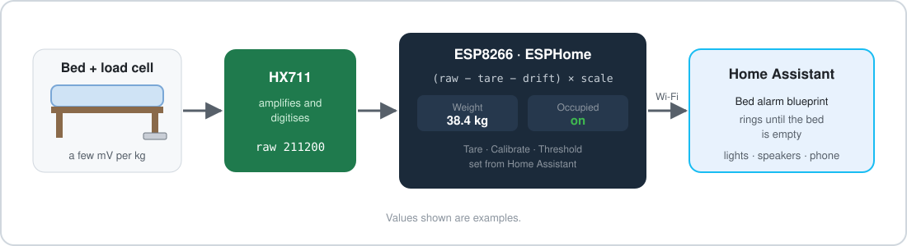
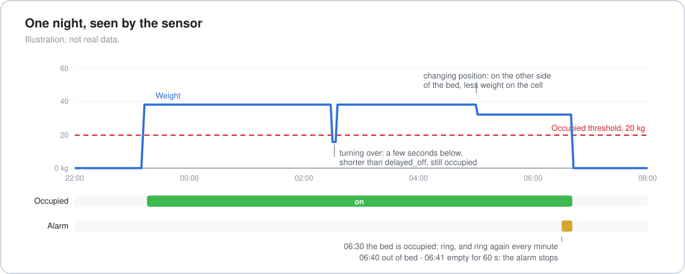
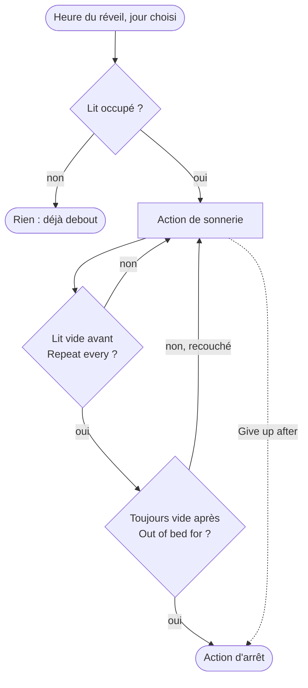
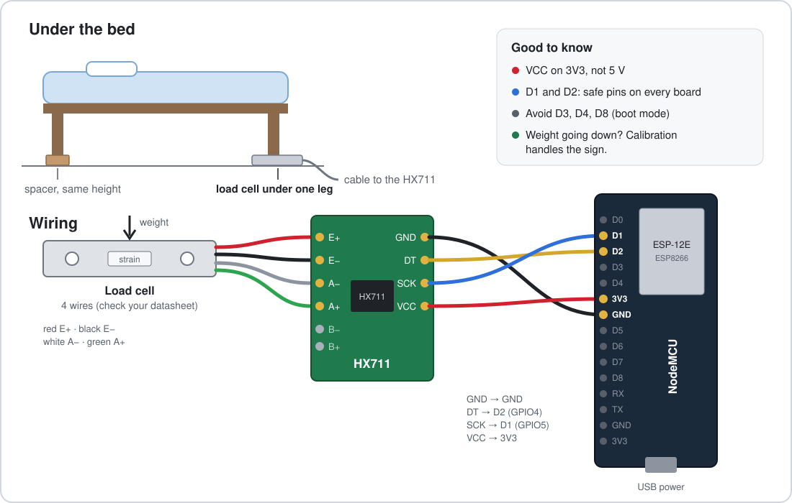

# Présence au lit pour Home Assistant

[English](README.md) | **Français**

Une cellule de charge sous le lit, un HX711 et un ESP8266 sous ESPHome : Home Assistant sait si
quelqu'un est couché. Le dépôt fournit aussi un blueprint de réveil qui sonne tant qu'on n'est pas
vraiment sorti du lit.

> **État :** cette version n'a pas encore été testée sur du matériel. C'est une réécriture d'un
> capteur qui tournait chez moi en 2020 (voir [Origine](#origine)). Le firmware compile pour un NodeMCU
> (ESPHome 2026.10) ; ouvrez une issue si quelque chose se comporte autrement sur votre carte.

## Ce qu'on obtient

Appareil ESPHome (`esphome/bed-presence.yaml`) :

| Entité | Type | Rôle |
|---|---|---|
| Occupied | capteur binaire | allumé tant que le poids dépasse le seuil, avec des délais pour qu'un retournement ne le fasse pas basculer |
| Weight | capteur (kg) | poids calibré, inconnu tant que la balance n'est pas calibrée |
| Raw value | capteur (diagnostic) | valeur brute du HX711, pour calibrer et dépanner |
| Occupied threshold | nombre (kg) | réglable depuis Home Assistant, 20 kg par défaut |
| Calibration weight | nombre (kg) | le poids connu qui sert à calibrer |
| Tare / Calibrate / Restart | boutons | calibrer sans reflasher |

- La tare et le calibrage se font depuis Home Assistant et survivent aux redémarrages et aux coupures
  de courant.
- Remise à zéro lente : les cellules dérivent avec la température. Tant que le lit est vide et que la
  mesure reste à moins de 2 kg de zéro, le zéro suit la dérive. Cette correction n'est jamais écrite
  en flash.
- Pas de tare au démarrage : après une coupure de courant la nuit, quelqu'un peut être couché.

Blueprint (`blueprints/automation/bed_alarm.yaml`) : à l'heure du réveil, si le lit est occupé, il
lance votre action de sonnerie chaque minute jusqu'à ce que le lit soit resté vide une minute. Se
recoucher la relance. Il abandonne au bout de 30 minutes. Tout cela se règle.

## Matériel

- Une carte ESP8266 (NodeMCU ou Wemos D1 mini). Un ESP32 convient aussi : changer le bloc
  `esp8266:` et les broches.
- Un module HX711.
- Des cellules de charge : une cellule en barre sous un pied du lit, ou quatre demi-ponts (ceux des
  pèse-personnes) sous les quatre pieds. Voir [docs/wiring.md](docs/wiring.md).
- Une alimentation USB.

Les schémas sont en anglais.

C'est un capteur de présence, pas une balance. Avec une seule cellule sous un pied, la mesure dépend
de l'endroit où l'on est couché. Ce n'est pas grave : il suffit de distinguer un lit vide d'un lit
occupé.

## Installation

1. Câbler : [docs/wiring.md](docs/wiring.md).
2. Copier `esphome/bed-presence.yaml` dans le dossier ESPHome, créer `secrets.yaml` à partir de
   `secrets.example.yaml`, adapter les `substitutions` (broches, nom).
3. Flasher, puis ajouter l'appareil dans Home Assistant (il est découvert).
4. Calibrer : [docs/calibration.md](docs/calibration.md). Deux boutons et un poids connu.
5. Régler **Occupied threshold** : environ la moitié du poids de la personne la plus légère, tel que
   l'affiche **Weight**.
6. Importer le blueprint et créer un réveil.

La documentation détaillée est en anglais. Problèmes : [docs/troubleshooting.md](docs/troubleshooting.md).

## Origine

En 2020, j'avais glissé une cellule de charge sous mon lit, avec un HX711 et un ESP8266 sous
ESPHome, et un réveil qui ne s'arrêtait que quand le lit était vide. La configuration d'origine
faisait environ 35 lignes : un capteur HX711, calibré en deux points directement dans le YAML. Ce
dépôt en est une version neuve et générique : calibrage et seuil depuis Home Assistant, présence
avec délais, correction de dérive et réveil en blueprint. Elle a été écrite avec l'aide d'une IA et
relue par moi.

Un [AGENTS.md](AGENTS.md) donne les consignes aux assistants de code IA.

## Licence

MIT. Fait par Nicolas Holder. D'autres projets sur [nholder.fr](https://nholder.fr).
