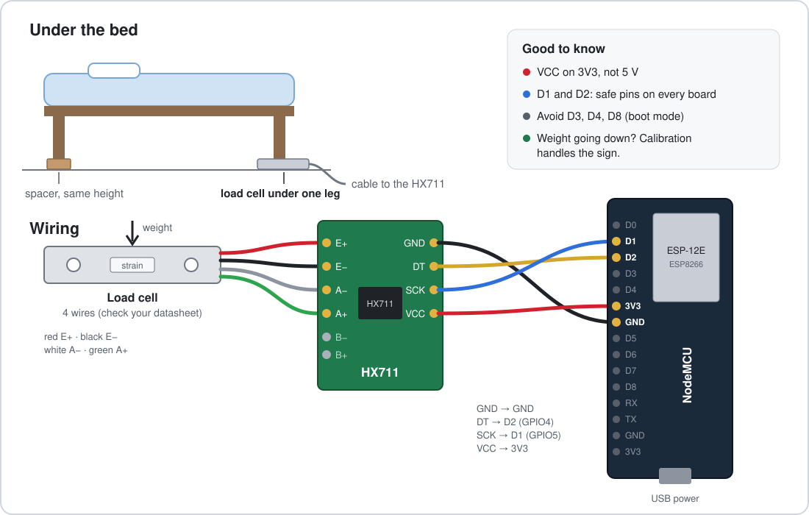
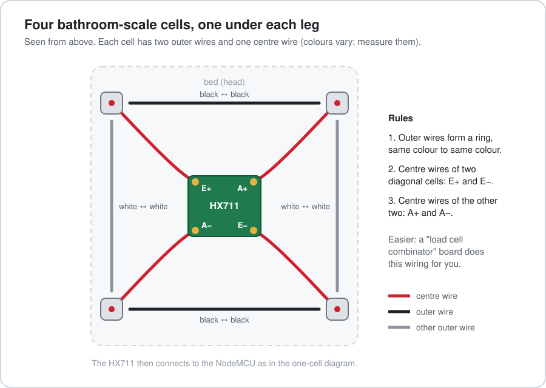

# Wiring

## HX711 to the ESP8266

| HX711 | NodeMCU / D1 mini | Note |
|---|---|---|
| VCC | 3V3 | 3.3 V, not 5 V: the ESP8266 pins are not 5 V tolerant |
| GND | GND | |
| DT (DOUT) | D2 (GPIO4) | `dout_pin` substitution |
| SCK (CLK) | D1 (GPIO5) | `clk_pin` substitution |

D1 and D2 are safe on every ESP8266 board. Avoid D3, D4 and D8: they decide the boot mode and can
stop the board from starting.

## Load cells to the HX711

### One bar load cell (4 wires)

| Cell wire (usual colour) | HX711 |
|---|---|
| Red (excitation +) | E+ |
| Black (excitation −) | E− |
| White (signal −) | A− |
| Green (signal +) | A+ |

Colours vary between makers: check the datasheet of your cell. If the weight goes down when you
lie down, nothing is wrong: calibration handles the sign. Swapping A+ and A− also flips it.

Put the cell under the bed leg nearest to where you sleep, on a hard, flat support. The leg must rest
on the cell only, not also on the floor. Put a spacer of the same height as the cell under the
other legs, so the bed stays level.

### Four half-bridge cells (3 wires, from bathroom scales)

Four 50 kg half-bridge cells, one under each leg, form one full bridge. The easiest way is a small
"load cell combinator" board, which takes the four cells and connects them for you. Without it:

- the two outer wires of each cell connect to the outer wires of its two neighbours, so that the four
  cells form a ring (same colour to same colour);
- the centre wires of two diagonally opposite cells go to E+ and E−;
- the centre wires of the other two go to A+ and A−.

Colours vary between makers: find the centre wire with a multimeter. The resistance between the two
outer wires is about twice the resistance between the centre wire and either outer wire.

## Cable and placement

- Keep the HX711 close to the cells and the cable between HX711 and ESP8266 short. A long cable
  between the cells and the HX711 picks up noise.
- Fix the electronics to the bed frame so they do not move when the bed is made.
- A USB power supply on a socket near the bed. Avoid a socket switched with the bedside lamp.
